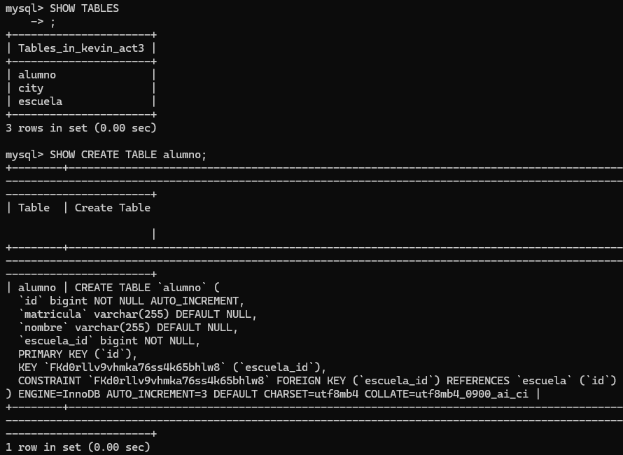
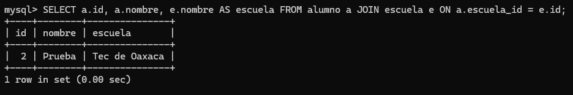
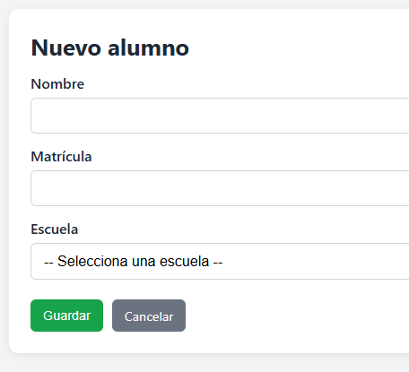
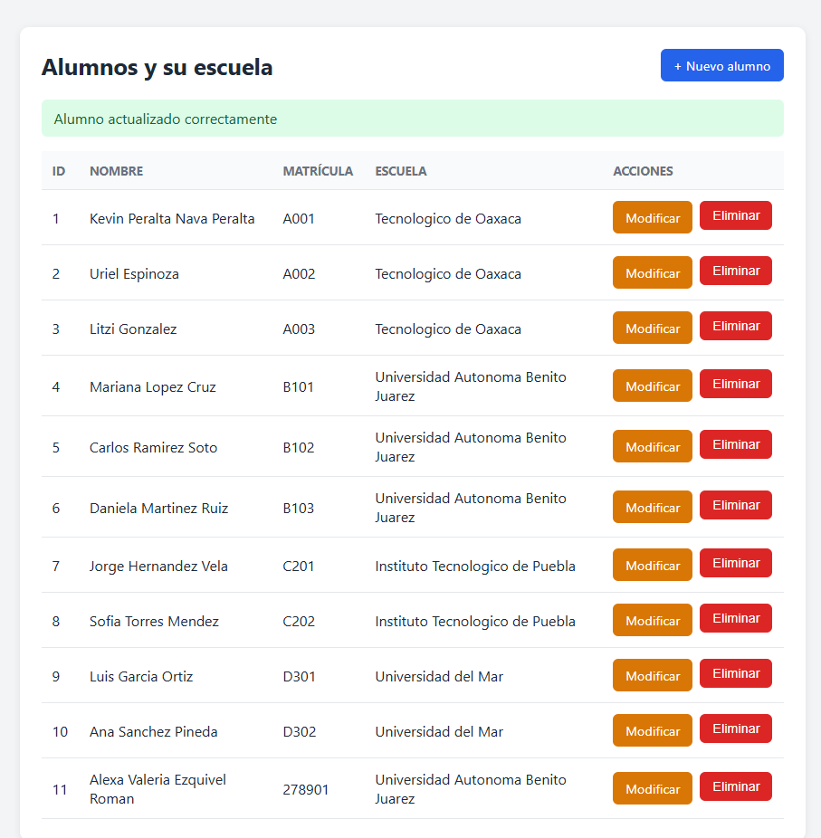
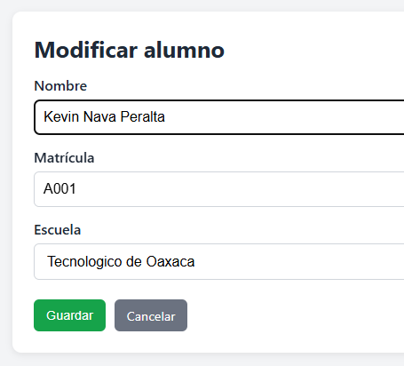
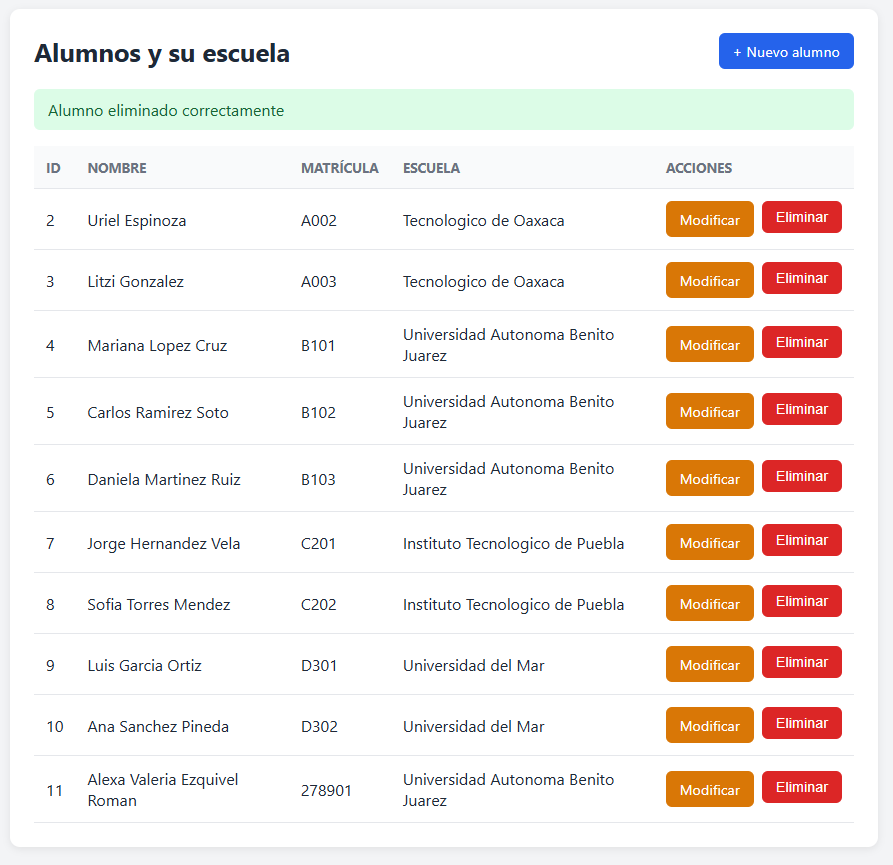

# Actividad 3 - CRUD con Spring Boot, JPA y MySQL

- **Materia:** Programación Web
- **Autor:** Kevin Peralta Nava Peralta

Pagina web con CRUD completo de **Alumnos** conectado a una base de datos MySQL, con una relación de **Escuela** y **Alumno**.
## Enlaces

- **Proyecto en el VPS (puerto 2755):** http://94.130.98.27:2755/alumnos
- **API en el VPS:** http://94.130.98.27:2755/api/alumnos
- **Colección de Postman:** [docs/json/coleccion-act3.json](docs/json/coleccion-act3.json)

Las Actividades 1 y 2 siguen corriendo en sus puertos originales (2750 y 2753), sin verse afectadas.

## Entidades y relación

| Entidad | Campos |
|---|---|
| `Escuela` | `id`, `nombre`, `ciudad` |
| `Alumno` | `id`, `nombre`, `matricula`, `escuela` |

**Relación:** una Escuela tiene muchos Alumnos y cada Alumno pertenece a una sola Escuela.

- En `Alumno`: `@ManyToOne` con `@JoinColumn(name = "escuela_id")`. La llave foránea `escuela_id` queda en la tabla `alumno`.
- En `Escuela`: `@OneToMany(mappedBy = "escuela")`.

## Estructura del proyecto

```
src/main/java/.../
├── model/        Escuela, Alumno (entidades JPA)
├── repository/   EscuelaRepository, AlumnoRepository (JpaRepository)
├── service/      EscuelaService, AlumnoService (lógica de negocio)
├── dto/          AlumnoRequest, AlumnoResponse, AlumnoForm
└── controller/   EscuelaController, AlumnoController (REST), AlumnoVistaController (vistas)
src/main/resources/templates/
├── alumnos.html       Lista de alumnos con botones de acción
└── alumno-form.html   Formulario para crear y modificar
```

## Endpoints

### API REST (JSON)

| Método | Ruta | Descripción |
|---|---|---|
| POST | `/api/escuelas` | Crear una escuela |
| GET | `/api/escuelas` | Listar escuelas |
| POST | `/api/alumnos` | **Crear** un alumno |
| GET | `/api/alumnos` | **Leer** todos los alumnos |
| GET | `/api/alumnos/{id}` | **Leer** un alumno |
| PUT | `/api/alumnos/{id}` | **Actualizar** un alumno |
| DELETE | `/api/alumnos/{id}` | **Eliminar** un alumno |

Ejemplo de cuerpo para crear o actualizar un alumno:

```json
{ "nombre": "Kevin Nava Peralta", "matricula": "A001", "escuelaId": 1 }
```

La respuesta incluye el nombre de la escuela, no solo su id:

```json
{ "id": 1, "nombre": "Kevin Nava Peralta", "matricula": "A001", "escuelaId": 1, "escuelaNombre": "Mi Escuela" }
```

### Vistas (Thymeleaf)

| Ruta | Descripción |
|---|---|
| `/alumnos` | Lista con los botones **Nuevo alumno**, **Modificar** y **Eliminar** |
| `/alumnos/nuevo` | Formulario para crear un alumno |
| `/alumnos/{id}/editar` | Formulario para modificar un alumno |

---

## Capturas de pantalla

### 1. Entidades relacionadas (tablas en MySQL)

Tablas `escuela` y `alumno`, con la llave foránea `escuela_id`.



### 2. Relación reflejada en la base de datos

Consulta que une `alumno` con `escuela` y muestra el nombre de la escuela.



### 3. Crear (Create)



### 4. Leer (Read)

La lista muestra el nombre de la escuela de cada alumno, no solo su id.



### 5. Actualizar (Update)



### 6. Eliminar (Delete)


